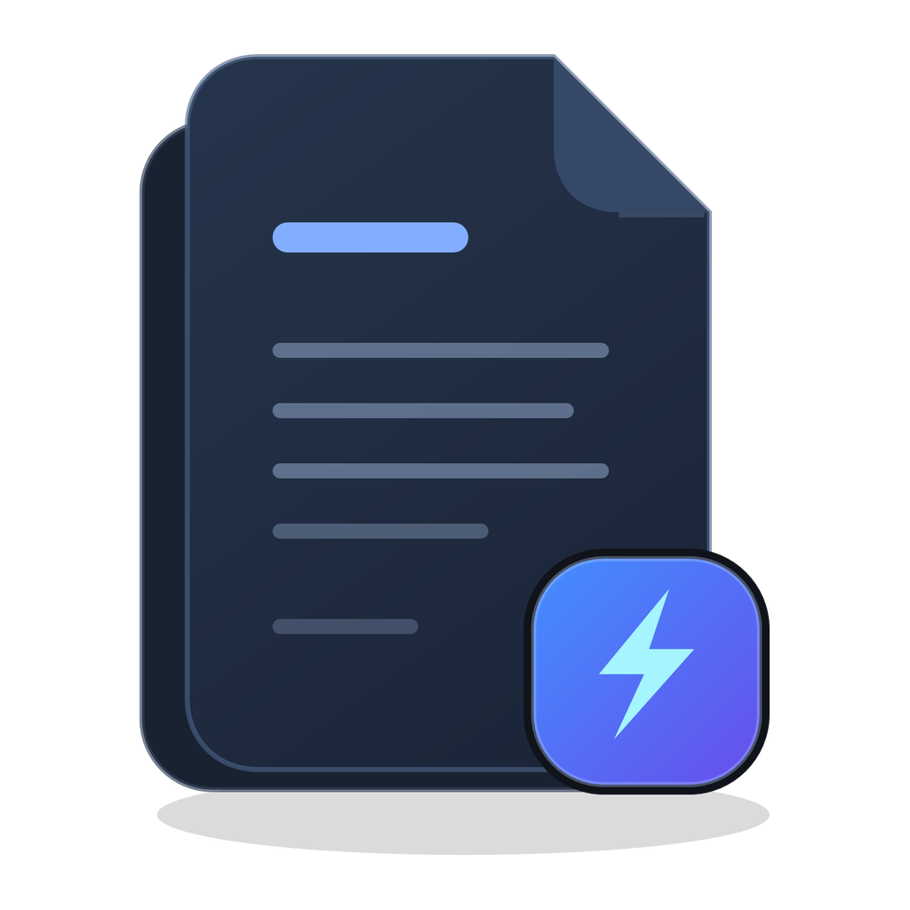

# Voltura Markdown



A fast, compact, read-only Markdown reader for Windows 10/11 x64. One portable executable, a minimal interface, and light/dark themes.

## Download

Visit the [product website](https://markdown.voltura.se/) or open [Releases](https://github.com/voltura/voltura-markdown/releases) and choose an asset:

| Download | Use |
| --- | --- |
| **`vmd.exe`** | Portable reader. Download, keep in a suitable folder, and run. |
| **`VolturaMarkdown-Setup-<version>-win-x64.exe`** | Per-user installation with a Start menu shortcut and Windows uninstall entry. |

**1.1.8** includes self-signed, timestamped executables. GitHub's source archives do not contain a built app; download one of the executable assets above.

Setup requires no administrator access. Its optional **Choose as default Markdown reader** checkbox opens Windows Default apps so you can make the final choice.

## Use

Double-click the app, use **Ctrl+O**, or drop a `.md` file onto its window. You can also pass a full document path:

```powershell
.\vmd.exe "C:\Documents\example.md"
```

The reader starts in a normal window without a document, and fullscreen when launched with a document (unless **Start fullscreen** is disabled). **F11** switches window modes. **Escape** closes directly when launched with a file path, including from Explorer; otherwise it leaves fullscreen or closes a normal window. Search and Help/About are dismissed first. The fullscreen **X** exits directly. Press **F1** for Help.

To update, close the reader and replace the portable executable, or run the newer Setup. Documents and preferences are retained.

## Features

- Formatted Markdown and selectable, read-only source.
- Search, copy, zoom, smooth scrolling, and DPI-aware controls.
- Light/dark themes, including menus, tooltips, scrollbars, Help, and About.
- Tables, task lists, footnotes, alerts, Unicode, and local/HTTPS images.
- Copy file/name/path, show in Explorer, and choose an external editor.
- Optional `.md` registration through Windows Settings.

The portable reader needs no companion DLLs, browser engine, .NET, or Visual C++ redistributable. It never edits or saves documents.

## Documentation

- [User guide](docs/USER-GUIDE.md) · [Supported formats and limits](docs/COMPATIBILITY.md)
- [Release notes](docs/releases/1.1.8.md) · [Changelog](CHANGELOG.md)
- [Folder and document map](docs/REPOSITORY.md) · [Architecture](docs/ARCHITECTURE.md)
- [Build and verify](docs/BUILDING.md) · [Code style](docs/CODE-STYLE.md) · [Performance](PERFORMANCE.md)
- [Local releases and signing](docs/RELEASING.md) · [Product website](docs/PAGES.md)
- [Contributing](CONTRIBUTING.md) · [Security reporting](SECURITY.md)

The separate `site/` product website is for readers; this README introduces the source repository. Build, signing, release, and website publication use local scripts, without GitHub Actions.

## License

[MIT](LICENSE), copyright © 2026 Voltura AB. Developed by Joakim Skoglund. Dependencies and test fixtures retain their [own licenses and attribution](THIRD-PARTY-NOTICES.md).
